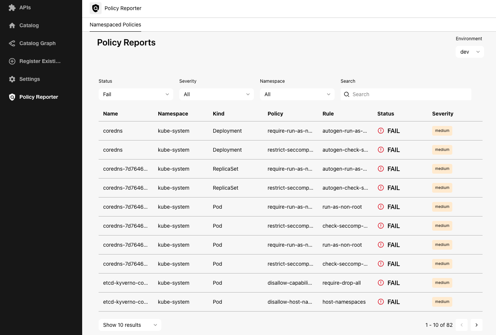

# Backstage Policy Reporter plugin

Shows [Policy Reporter](https://kyverno.github.io/policy-reporter/) results in
Backstage. You can see which Kyverno policies (and other Policy Reporter
sources) pass or fail for each catalog entity, and browse every policy result in
a cluster.



## Features

- A **Policy Reporter** tab on entity pages with the results for that entity's
  Kubernetes resources
- A **Policy Reporter** page with namespaced and cluster-scoped results for each
  cluster
- Filters by status, severity, namespace, source, kind, category, and policy
- An optional **Validating Admission Policies** tab, using the
  [Policy Reporter VAP plugin](https://github.com/kyverno/policy-reporter-plugins/tree/main/plugins/vap)
- Support for both the new and the legacy Backstage frontend systems

## Packages

| Package                                                                                | Install in         | Description                                                    |
| -------------------------------------------------------------------------------------- | ------------------ | -------------------------------------------------------------- |
| [`@kyverno/backstage-plugin-policy-reporter`](plugins/policy-reporter)                 | `packages/app`     | Frontend plugin. Setup, catalog configuration, and extensions. |
| [`@kyverno/backstage-plugin-policy-reporter-backend`](plugins/policy-reporter-backend) | `packages/backend` | Backend plugin. Configuration and authentication.              |
| [`@kyverno/backstage-plugin-policy-reporter-common`](plugins/policy-reporter-common)   | —                  | Shared annotations, types, and API client.                     |

## Quick start

1. Install the packages:

   ```bash
   yarn --cwd packages/app add @kyverno/backstage-plugin-policy-reporter
   yarn --cwd packages/backend add @kyverno/backstage-plugin-policy-reporter-backend
   ```

2. Add the backend plugin in `packages/backend/src/index.ts`:

   ```ts
   backend.add(import('@kyverno/backstage-plugin-policy-reporter-backend'));
   ```

3. Register each cluster with its Policy Reporter API endpoint:

   ```yaml
   apiVersion: backstage.io/v1alpha1
   kind: Resource
   metadata:
     name: aks-dev
     annotations:
       kyverno.io/endpoint: https://your-domain/policy-reporter/api/
   spec:
     type: kubernetes-cluster
   ```

4. Annotate your entities and add a dependency on their clusters:

   ```yaml
   metadata:
     annotations:
       kyverno.io/namespace: default
       kyverno.io/kind: Deployment,Pod
       kyverno.io/resource-name: my-service
   spec:
     dependsOn:
       - resource:default/aks-dev
   ```

5. Set up the frontend. With the new frontend system and feature discovery,
   the plugin is ready after installing it. For the legacy frontend system, or to
   configure extensions, see the
   [frontend plugin README](plugins/policy-reporter#new-frontend-system).

The [frontend plugin README](plugins/policy-reporter) explains each step in detail.

## Contributing

- [CONTRIBUTING.md](CONTRIBUTING.md): pull requests, DCO sign-off, and changesets
- [DEVELOPMENT.md](DEVELOPMENT.md): local development with a Kubernetes cluster
- [ARCHITECTURE.md](ARCHITECTURE.md): request flow and package responsibilities
